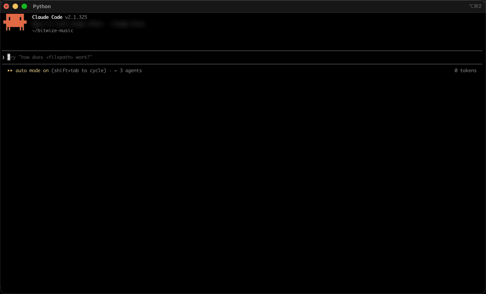

# Suno MCP: Setup, Costs and Track-File Mapping

Suno runs an official MCP server (beta since October 2026). When it is connected, the plugin can generate a track, play the takes and import the keeper without a trip to suno.com. When it is not, everything falls back to the clipboard flow and nothing breaks.

> **Related skills**: `/bitwize-music:generate`, `/bitwize-music:listen`, `/bitwize-music:check-take`, `/bitwize-music:edit-take`, `/bitwize-music:extend-take`, `/bitwize-music:sound-effects`, `/bitwize-music:suno-voice`, `/bitwize-music:import-audio`, `/bitwize-music:album-art-director`, `/bitwize-music:lyric-video`, `/bitwize-music:promo-director`
> **Related docs**: [models.md](models.md), [creative-sliders.md](creative-sliders.md), [tips-and-tricks.md](tips-and-tricks.md)

Everything marked *measured* was tested on a Premier account. The server is in beta and its tools change — treat the live tool definitions as the authority over this page.

---

## Setup

The plugin does not ship the Suno server; you add it to your own Claude Code once:

```bash
claude mcp add --transport http suno https://api.suno.com/mcp
```

Then run `/mcp` in a session and sign in to your Suno account. Name the server `suno` as above — each skill pre-approves the Suno tools it uses under that name, and Claude Code asks before it calls any other. Add `--scope user` to the command to have the server in every project; without it, it belongs to the project you ran the command in. Songs made this way use your plan's credits and land in your Suno library.

Session start checks for the server (`health_check` reads Claude Code's and Codex's MCP registrations for any server on `api.suno.com`) and shows these steps while none is registered. `generation.suno_mcp_reminder: false` in your config turns that reminder off.

Other assistants: see Suno's [connection guide](https://help.suno.com/en/articles/14551425).

---

## Preflight

Every skill that uses Suno tools runs these checks first:

1. **Find the tools.** Look for `audio-create`, `audio-wait` and `account-usage` on any connected MCP server (a tool search for `suno audio-create` finds them). Do not assume the `mcp__suno__` prefix — the user may have named the server differently.
2. **Not found** → the server is not configured. Give the setup command above and offer the fallback below.
3. **Found, but a call returns an authentication error** → tell the user to run `/mcp` and sign in.
4. **Read the account once** with `account-usage`: `allowed_models`, `features`, `suno_account.credits_remaining`, `suno_account.download_credits_remaining` and `suno_account.plan.name` (Suno Studio comes with Premier only; see § Suno Studio).
5. **Trust the live tool definition.** Send only arguments the tool lists today. If a call is rejected for an unknown argument, drop that argument, tell the user, and retry once. The exception is `dry_run` on a Visuals tool: without it the call spends credits, so stop instead.
6. **A session lists the server's tools as they were when it started.** Suno adds tools without notice. Before deciding that one is missing, restart the session, or reconnect the server from `/mcp`.

---

## What Things Cost

Suno keeps three balances: **song credits**, **download credits** (Free 7 lifetime, Pro 20 a month, Premier 60 a month) and **Visuals credits** for images and video, which are bought separately. `account-usage` reports them as `suno_account.credits_remaining`, `download_credits_remaining` and `visuals_credits_remaining`. The plugin spends Visuals credits on one thing, album art made through Suno (§ Visuals).

| Action | Song credits | Download credits |
|---|---|---|
| `audio-create` — one call makes **two** songs | 10 *(measured)* | 0 |
| `audio-create` with Max Mode | a multiple of that (2× on suno.com) | 0 |
| `audio-create` editing a take (`reference_audio_ids`) — two edited takes | 10 *(measured)* | 0 |
| `audio-create` making an instrumental version of a take — two takes | 10 *(measured)* | 0 |
| `audio-create` in a saved Voice (`voice_id`) — two songs | 10 *(measured)* | 0 |
| `audio-create` playing a MIDI score (`midi_upload_id`) — two songs | 10 *(measured)* | 0 |
| `audio-covers-create` — two covers | 10 *(measured)* | 0 |
| `audio-extensions-create` — two continuations | 10 *(measured)* | 0 |
| `audio-full-song` — joining a continuation to what came before | 0 *(measured)* | 0 |
| `speech-create` — two spoken clips | 10 *(measured)* | 0 |
| `sounds-create` — two sounds of about 20 seconds | 2 *(measured)* | 0 |
| `midi-upload-create`, `midi-upload-complete`, `voices-list` | 0 *(measured)* | 0 |
| `audio-midi` of a stem made with Get Stems | 0 *(measured)* | 0 |
| `audio-stems-create`, `twelve` (two takes of 12 stems) | 50 *(measured)* | 0 |
| `audio-stems-create`, `two` (vocals + instrumental) | 10 | 0 |
| Listen on the song's suno.com page | 0 | 0 |
| First `audio-download` of a song, MP3 or WAV | 0 | 1 *(measured)* |
| Any later download of that song, either format | 0 | 0 *(measured)* |
| Downloading the stems of a song that has been downloaded | 0 | 0 *(measured)* |
| A WAV downloaded in Suno Studio (Premier): select the whole waveform, Download .WAV | 0 | 0 *(measured once)* |
| Playing a file already on disk | 0 | 0 |
| `workspaces-create`, `workspaces-update-clips`, `workspaces-list` | 0 *(measured)* | 0 *(measured)* |
| `audio-listen` question, `audio-lyrics-alignment`, `audio-analysis` | 0 *(measured)* | 0 *(measured)* |
| `audio-like`, `audio-unlike` | 0 *(measured)* | 0 *(measured)* |
| `playlists-create`, `playlists-add-clips`, `playlists-list-clips` | 0 *(measured)* | 0 *(measured)* |

A `duration` of 60 seconds cost the same 10 credits as an open-ended song.

A terminal audition **is** a download. The take you keep costs one download credit either way; each rejected take you play in the terminal costs one more. The browser is free, which is why it is the default.

---

## Track File → Request

`get_generation_request(album, track)` reads what kind of request the track makes, names the Suno tool for it in `tool`, and builds that tool's arguments:

| Kind | When | Tool |
|---|---|---|
| `song` | Any other track | `audio-create` |
| `cover` | **Source audio** in the Cover / Voice Setup block holds a `https://suno.com/song/<id>` address | `audio-covers-create` |
| `speech` | The frontmatter says `spoken: true` | `speech-create` |
| `midi` | The tool is given a `midi_upload_id` (`/bitwize-music:generate --midi`) | `audio-create` |

Anything the track file sets that the kind's tool cannot carry comes back under `ignored`, with the reason, and `/bitwize-music:generate` shows it before the go-ahead. A song maps like this:

| Track file | Argument | Notes |
|---|---|---|
| Title | `title` | ≤ 256 characters |
| Lyrics Box | `lyrics` | ≤ 5000. Kept for instrumentals: tags-only lyrics were accepted and not sung *(measured)* |
| Style Box | `style` | ≤ 1000. Used as written when Variety is Off. `metadata.style` always echoes what was sent, so it cannot show whether Variety rewrote it; `metadata.controls.variety` says which Variety the take was made at (§ Take Check) |
| Exclude Styles | `negative_style` | ≤ 1000. `(none)` or an untouched placeholder sends nothing. Old-style `no drums` items are sent bare (`drums`), with a warning to fix the file |
| `instrumental: true` | `instrumental` | Frontmatter and the Track Details row must agree |
| Model `v6` / `v6-wild` / `v6-mini` | `model` | `Custom: <name>` is not offered — use suno.com |
| Max Mode `On` | `max_mode: true` | `Off` sends nothing. Suno asks that Max Mode be turned on only at the user's request, so `/generate` names it and its cost before asking for the go-ahead |
| Vocal Gender | `vocal_gender` | `male` / `female`; `—` sends nothing; never sent for an instrumental |
| Duration `m:ss` | `duration` | Seconds, 15–360, a hard cap. `Auto` sends nothing |
| Weirdness / Style Influence 0–100 | `controls.weirdness` / `controls.style_influence` | Sent as 0–1 |
| Variety `Off` / `Normal` / `High` / `Extra` / `Max` | `controls.variety` | 0–4. Always sent, and `Off` (0) when the row is blank or the section is missing: left out, Suno applies the model's own default, which is Normal on v6 and v6-mini and rewrites the Style Box |

The sliders, `negative_style` and `vocal_gender` need the `controls.advanced` feature; `controls.variety` does not. The tool lists what needs it under `needs_grant` (`controls.weirdness`, `controls.style_influence`, `controls.audio_influence`, `negative_style`, `vocal_gender`); drop those, and say so, when `account-usage` does not list the feature.

### Covers and Voices

Both come from the track's **Cover / Voice Setup** block (`templates/track.md`). A cell still holding the template's bracketed placeholder counts as empty.

| Track file | Argument | Notes |
|---|---|---|
| Source audio: a `https://suno.com/song/<id>` address | `id` on `audio-covers-create` | The song to cover — your own, or one suno.com lets you remix. A share link (`suno.com/s/…`) carries no id, and audio that is not on Suno cannot be covered from here: both stop the request rather than quietly making an original |
| Style Box | `style` | The **new** style |
| Lyrics Box | `lyrics` | What gets sung. A cover sent no lyrics comes back instrumental, so an instrumental track sends none and a vocal track must have them |
| Audio Influence `70`, `70%` or `0.7` | `controls.audio_influence` | Likeness to the source for a cover, to the Voice for a song. Sent only when there is one of the two |
| Voice: the saved Voice's name | `voice_id` | The tool returns `voice: {name}`; the skill finds the id with `voices-list(query)` — own Voices first, then `collection: "loved"` — and adds it. Vocal Gender is not sent with a Voice, and a Voice on an instrumental track is refused |

`audio-covers-create` has no `instrumental` and no `vocal_gender`; the rest (model, Max Mode, duration, exclusions, sliders, workspace) goes along as for a song.

**Putting a Voice on a track.** `/bitwize-music:suno-voice` finds the Voice with `voices-list(query)` (own, then `collection: "loved"`) and only then calls the plugin's `set_track_voice`, which writes the **Voice** row, adds the block above Suno Inputs when the track has none, and records the song the Voice was made from (`root_clip_id`). With no track named it covers every track of the album that has lyrics and lists the instrumental ones it skipped. `"—"` takes the Voice off. Free: nothing is generated until `/generate`.

**Making a new Voice.** `voices-start` takes no arguments and returns a suno.com `url` where the user records and verifies the Voice; it then appears in `voices-list`. Suno's rule is never to ask the user for recordings or files. The plugin calls it only when the user asks to make a Voice. Not measured.

*Measured:* a cover of a 52-second take in a new style made two covers of 62 and 65 seconds for 10 credits; they took the source's title and came back with `metadata.cover_audio_id`. At Audio Influence 70 the cover kept the source's tempo (about 95 BPM measured) although the new style asked for 80. A song sent with a `voice_id` cost the same 10 credits and came back with `metadata.voice_id`.

### Spoken Word

`spoken: true` in a track's frontmatter sends it to `speech-create`.

| Track file | Argument | Notes |
|---|---|---|
| Lyrics Box | `script` | Spoken word for word. Section tags and bracketed cues are taken out; blank lines between paragraphs stay. ≤ 5000 characters |
| Style Box | `style` | Delivery tags ("calm narrator, warm, close microphone"), and the style of the music bed when there is one |
| Backing Music `On` (Generation Settings) | `backing_music: true` | Off unless the row says On |
| Vocal Gender, Duration, Exclude Styles, Voice | `vocal_gender`, `duration`, `negative_style`, `voice_id` | As for a song |

Speech has no model, no Max Mode and no `controls`, so those settings are listed under `ignored`.

*Measured:* one call made two clips for 10 credits, 20 and 50 seconds long from the same four-sentence script. Suno reworded the delivery tags for each ("calm narrator, warm, close microphone" became "tense and strident delivery" on one and "deep bass register, flat affectless monotone" on the other), which is why the two differ. The listening agent heard the script word for word and no music.

### A MIDI Score

`/bitwize-music:generate <album> <track> --midi [file]` has Suno play a melody from a MIDI file.

1. `get_midi_score_plan` checks the file — a MIDI header, at most 256 KB — and without a file uses the track's own under `sheet-music/source/`, where MIDI From Suno saves a transcription.
2. The upload is three free steps: `midi-upload-create` (no arguments) answers `{midi_upload_id, upload_url, upload_fields, max_bytes}`; the file goes to `upload_url` as a multipart form with every field first and the file last as `file` (HTTP `204` on success); `midi-upload-complete(id)` checks it.
3. `get_generation_request(album, track, midi_upload_id)` builds the request: `midi_upload_id`, a `description` made from the Style Box ("An instrumental that plays my melody, in this style: …"), `instrumental: true` and `model: "v6-wild"`, the only model that plays a score.

A score is sent in Suno's simple mode, which takes a description and nothing else of the track's: no lyrics, no style field, no exclusions, no Max Mode, no sliders. So a score makes an **instrumental**. For an instrumental track the takes are the track. For a vocal track they are sketches: put the chosen sketch's address in Source audio and generate again, and the cover sings the Lyrics Box over it.

*Measured:* a two-track, 3 KB score of about 55 seconds made two instrumentals of 64 seconds for 10 credits; `metadata.lyrics` read `[Instrumental]` and Suno wrote the style from the description. The listening agent heard solo guitar carrying the melody; the bass and brushed snare the description also named were not heard. Covering a sketch with lyrics was not measured as a chain — each call was, on its own.

---

## Tool Notes

**Generation**
- `audio-create` answers `{"clip_ids": [a, b], "id": a, "status": "submitted"}`. There is no way to ask for one song.
- Wait with `audio-wait`, passing every id in `ids` and `until: "complete"`. It returns after about 50 seconds whether or not the songs are done; call it again while any is pending.
- Pass an `idempotency_key` and reuse it on a retry, so a timeout cannot charge twice.
- Clip data (`audio-wait`, `audio-retrieve`, the library tools) carries `song_url` — the suno.com page — and no audio link.
- Clip data also carries the settings a song was made with: `metadata.model`, `negative_style`, `max_mode` and `controls`. *Measured:* two takes of a track that asks for v6, Variety Off, Max Mode on, two exclusions and three sliders came back with all four, holding exactly those values; four takes made as edits came back with `model` alone. `/bitwize-music:check-take` holds them against the track file.

**Downloads**
- `audio-download` without `confirm` answers `requires_credit` when the download would spend a download credit. Ask the user, then call again with `confirm: true`.
- `processing` means the file is being prepared: call `audio-download` again.
- Leave a second or two between calls. A burst is refused with `rate_limited` and a `retry_after_seconds`.
- Links last one hour. WAV is 16-bit / 48 kHz stereo; MP3 is about 184 kbps.

**Stems**
- `audio-stems-create` answers `{"id": "stemgrp_…", "status": "pending", "stems": [{"name", "audio_id", "take", "status", "duration"}, …]}`. Poll `audio-stems-retrieve` with the source clip id and that group id until `status` leaves `pending` — about a minute and a half for a one-minute song.
- `twelve` names its parts `vocals`, `backing_vocals`, `drums`, `bass`, `guitar`, `keyboard`, `percussion`, `strings`, `synth`, `fx`, `brass`, `woodwinds`, each as take 1 and take 2. Import one take; the two are separate renderings and do not sum together.
- A part the song lacks still arrives, as a near-silent stem. The mix tools skip those on their own.
- Each stem is a song in the Suno library. They are not filed in a workspace automatically.

**Workspaces**
- `audio-create` takes `workspace_id`; the two new songs are filed there at creation. `/bitwize-music:generate` gets the id from `get_album_workspace` (the album README's `suno_workspace` block) and creates the workspace, named after the album, the first time.
- `workspaces-update-clips(id, add, remove)` files up to 50 songs per call and answers `skipped` for any it could not move; a song is in at most one workspace, so adding moves it. `workspaces-list(query)` finds a workspace by name. Nothing deletes or renames a workspace. See [workspace-management.md](workspace-management.md).

**Likes**
- Approving a take likes it on suno.com (`audio-like`), so keepers collect under Liked Songs; a keeper that is replaced is un-liked (`audio-unlike`). `generation.like_keeper: false` turns this off.
- The plugin never sends `dislike: true`: that rating is the user's to give. It is not a way to delete either — a dislike sent through the server left the song in the library *(measured)*, and the server has no tool that deletes a song, a workspace or a playlist. Delete on suno.com.

**Playlists and publishing** (`/bitwize-music:release-director`, only on request)
- `get_suno_release_plan` lists each track's approved take in track order and what is missing; `set_album_playlist` records the playlist in the album README (`suno_playlist`), so a later run updates it instead of making another.
- `playlists-create` answers `{id, name, playlist_url, visibility, clip_count}`. `playlists-add-clips` takes 100 ids per call and keeps the order given *(measured)*; re-adding is the only way to reorder. Visibility is fixed at creation; no tool renames or deletes a playlist.
- `audio-settings(visibility: "public")` publishes a song. The plugin calls it only when the user asks to publish, one confirmed list at a time; Suno allows 100 publishes a day.

**Whole albums** — `/bitwize-music:generate <album>` reads `get_album_generation_plan`: the tracks that pass the gates and map to a request, the blocked ones with the reason, the ones that already have takes, and an estimate (10 credits a call, 20 with Max Mode). One go-ahead covers the listed calls; they run one after another.

**MIDI** — `audio-midi(id)` transcribes a song to a multi-track `.mid`: 10 song credits, none for a stem made with Get Stems or a song transcribed before; it needs a plan with Studio. `get_suno_midi_plan` names the keeper and the target file under `sheet-music/source/`.

**Promo passage** — the promo generator starts its passage on the nearest beat on its own; `generate_promo_videos(..., start_s)` takes a chosen start, and Suno's listening agent can name the hook's first downbeat for free (see `/bitwize-music:promo-director`).

**Not used by the plugin yet**: the Visuals tools for Sequences and characters (§ Visuals), mashups, uploading audio to cover a file that is not on Suno (`audio-upload-create`), changing a song's title, lyrics or caption on suno.com (`audio-edit`), the library lists (`library-list`, `library-search`, `library-liked`), `audio-lyrics-alignment`, `audio-analysis`, and the other uses of `reference_audio_ids` (sampling, remastering).

**Not offered by the server**: deleting a song; Custom Models.

---

## Listening

`/bitwize-music:listen` opens a take's song page in your browser by default, because that is free. `--iterm2` shows the takes in panes beside the session instead, which is also free, with the track's Lyrics Box in a plain pane under them. The lyrics are not timed to the music: the plugin cannot see where Suno's player is. `--terminal` plays the take through your speakers.

- Terminal copies are saved as `~/.bitwize-music/cache/takes/<clip_id>.mp3` and replayed from there at no cost. The folder is a cache and safe to delete.
- Playback needs `mpv` (recommended — it can start mid-song), `ffplay` (part of ffmpeg) or macOS's built-in `afplay`.
- "Compare" plays the same passage of two to four files back to back (`compare_audio`): two takes, or a track's original, polished and mastered files. It needs `mpv`, the one player that takes several files with one start point and length.
- `prune_takes_cache` clears audition copies once a track has a keeper; copies of takes still awaiting a decision are kept. `/bitwize-music:listen` runs it when a keeper is named.
- `generation.listen_mode` sets the default (`browser`, `iterm2_browser` or `terminal`); `generation.listen_browser` picks the web browser for `browser` (`default`, an app name, or a path to one); `generation.listen_confirm_download: false` stops the question before a download credit is spent. See [config/README.md](../../config/README.md).

**iTerm2 panes** (`iterm2_browser`; measured on iTerm2 3.6.6)



- Needs macOS, iTerm2 3.6 or later and iTerm2's [Browser Plugin](https://iterm2.com/browser-plugin.html). Anywhere else — another terminal, tmux, an older iTerm2, no plugin, AppleScript refused — the takes open in the web browser and the tool says why.
- Each take opens as Suno's compact player, `https://suno.com/embed/<clip id>`, whose play button is at the top of the pane; on the full song page it is a scroll away. A share link from before MCP generation has no compact player and opens as the full page.
- The panes form a column to the right of the session, the first take on top, and iTerm2 shares the height evenly between them. The keyboard stays with the session.
- One click per take starts it: a browser never starts sound by itself, and iTerm2's AppleScript cannot press play, scroll a page or read its address.
- A browser pane takes its page only from a profile's Initial URL — a URL given as the pane's command closes the pane at once. So `open_song_page` writes one small profile per take to `~/Library/Application Support/iTerm2/DynamicProfiles/bitwize-music-listen-<pane id>.json` and waits the second or so iTerm2 needs to load it. `close_song_panes` closes the panes and removes that file; so does the next listen in the same session.
- Each Claude Code session has its own player panes, told apart by the iTerm2 pane the session runs in. Listening, or closing the players, in one session leaves another session's panes open. A session's files go once none of its panes is open any more ([#625](https://github.com/bitwize-music-studio/claude-ai-music-skills/issues/625)).
- The pane is iTerm2's own browser, with its own Suno sign-in. If a player says the song is not available, sign in to Suno in that pane once, or use `--browser`.

---

## Editing a Take

`/bitwize-music:edit-take` changes part of a take and keeps the rest: a word or a line, a cut or added line, a redone time range, an instrument added or dropped. It is the cheap fix for a take that is nearly right.

- **The call**: `audio-create` with the take in `reference_audio_ids`, a `description` that names the song by title ("In Paper Boats, change "…" to "…"."), and optionally `model` and `workspace_id`. `get_edit_request` builds it. Nothing else may go along: `duration`, `instrumental` and `vocal_gender` make Suno regenerate the whole song, `lyrics` and `style` are refused next to a `description`, and an id or link in the description is not allowed.
- **Two ways to say what changes**: the user's words, or the difference between the lyrics the take was made with (`audio-retrieve` → `metadata.lyrics`) and the track's Lyrics Box now — the way a pronunciation or wording fix made in the track file reaches a take.
- **More than five changed places** and Suno re-sings the whole song as a cover. The tool warns; regenerate instead.

*Measured, one word changed in a 55-second take:* one call made **two** edited takes for **10 song credits** in under a minute. Both kept the source's title and its length to the hundredth of a second, came back with `metadata.lyrics` updated and `metadata.description` holding the instruction, and were filed in the `workspace_id` given. The listening agent heard the new word in both; one of them also kept a quirk of the source take ("all lined up" for "are lined up"), which is what keeping the audio means.

### An Instrumental Version

The same call takes the vocals off a take: `get_edit_request(…, version: "instrumental")` writes "In <Title>, remove all the vocals to make an instrumental version. Keep everything else as it is."

- The two takes are logged with "instrumental version of take N" in their notes. Those words make them **versions**: `parse_generation_log` reports `version`, they are never the track's keeper, the take check leaves them out, and a ✓ on one marks the version to import.
- `get_suno_import_plan(album, track, version: "instrumental")` plans that import to `versions/<track>-instrumental.wav`, beside the album's audio and outside the folder the mastering tools read.

*Measured:* two takes for 10 credits, both 55.17 seconds against the source's 55.16, titled "<Title> (Instrumental)" by Suno, with no voice heard on either.

**An a cappella is not offered.** The same request for an a cappella returned one take of the source's length with no voice on it — the instrumental again — and one of 35 seconds, sung afresh with its guitar. The vocals stem of a stem split is the a cappella.

---

## Extending a Take

`/bitwize-music:extend-take` keeps a take up to a point and generates what follows: more of a song that stopped early, or a new second half.

- **The call**: `audio-extensions-create` with `id` (the take), `continue_at` (seconds into it), and `lyrics`, `style`, `negative_style`, `model`, `max_mode`, `controls` and `workspace_id` from the track. `get_extension_request` builds it. No `duration` is sent — it would cap the new ending — and the tool has no `vocal_gender`.
- **The words** are the track's Lyrics Box from a named section to the end (`from_section: "Verse 2"`, or `"Chorus #2"` for the second Chorus), so they have passed the track's checks. With no section named, no lyrics are sent and Suno writes on by itself.
- **The answer holds only the continuation.** `audio-full-song(id: <continuation>)` joins it to what came before, free, and returns a new song. Each of the two continuations ends its own chain, so each is joined and the two whole songs are logged as takes.
- A joined song is **not** filed in the workspace its parts are in, and `audio-full-song` takes no workspace: file it with `workspaces-update-clips`.

*Measured, a 55-second take carried on from 0:46 with a two-line verse:* one call made two continuations of 51 seconds for 10 credits (`metadata.extend_audio_id`, `metadata.continue_at`); each joined into a whole song of 97 seconds (`metadata.concat_clip_ids`) in the same voice, with the new verse sung about 14 seconds in. 0:46 fell inside a phrase, and the listening agent heard the cut — carry on from the end of a line. The joined song's `metadata.lyrics` is the source's whole lyrics followed by the continuation's, including the lines after the cut that are no longer sung.

---

## Sounds

`/bitwize-music:sound-effects` makes an effect, a one-shot or a loop: `sounds-create` with a `description` (≤ 500 characters), `loop`, and optionally `tempo`, `key` and `title`. `get_sound_request` builds it, takes the tempo and key from a track's Style Box when asked to fit the sound to it, and names the `sounds/` folder under the album's audio for saving.

- Two sounds of about 20 seconds for 1 credit each. The model and the length are Suno's choice. Sounds need Suno's Pro plan or higher.
- `sounds-create` takes no workspace; the skill files the two sounds afterwards.
- A sound is an ordinary song in the library: it opens, downloads and is listened to like one.

*Measured:* "soft rain on a window, gentle and steady" as a loop made one clip of rain and one with a piano melody over a soft background — hear both. A guitar loop asked for at 96 BPM in G was measured at 96 BPM; the listening agent named its key as D major, so the key is not confirmed.

---

## Take Check

`/bitwize-music:check-take` holds a take against its track file, and `/bitwize-music:generate` runs it on the two new takes while you listen. It reports; it never picks a take.

- **How**: `get_take_check_plan` numbers the lyric lines and writes the questions; the skill puts them to Suno's listening agent (`audio-listen`, read with `audio-listen-wait`); `evaluate_take_check` reads the JSON block the agent ends its answer with. A question holds 2,000 characters, so long lyrics are split across questions; only the first asks about the sound. The skill also reads each take once with `audio-retrieve` and hands the settings in its `metadata` to `evaluate_take_check`.
- **What it checks**: lyric lines not sung, sung with different words or hard to understand, with what was heard instead; tempo against the BPM in the Style Box (a tempo measured at double or half the one asked for counts as a match — a relaxed 96 BPM song is often measured at 190); the voice against Vocal Gender; Exclude Styles items that turn up among the instruments; problems the agent names; a clean ending; length against the track's Target Duration.
- **The settings Suno made the take with**: the model against the one the Generation Log says was sent, and Variety, Max Mode, the exclusions and each slider the track sets against the request the track file makes today. Only what Suno reports is compared, and a slider the track leaves alone never is, because nothing was asked of it. A track edited since the take was made shows as a difference, as its lyrics do. A take the log says was made from a MIDI score is held to its model alone, because a score goes out with no exclusions, Max Mode or sliders.
- **Limits**: five unanswered questions at a time, 200 a day. An answer arrives in under a minute.
- `generation.take_check: false` stops `/generate` from running it; the skill still runs on request.

**Why the listening agent** *(measured on a 52-second test song)*:

- `audio-lyrics-alignment` returned a transcript that left out the first two sung lines and stretched the third across their place, with every word marked `success` and `p_align: 1`. A local Whisper transcription of the same audio heard all four lines. A check built on alignment would have raised a false "two lines missing".
- The agent placed all four lines correctly, noticed "Kettle" sounding like "Cattle" (the local transcription heard the same) and, on the other take, "all lined up" for "are lined up".
- `audio-analysis` has the same tempo and key, but it returns every beat of the song — 164 entries for 52 seconds — which is too much to pass through a model for a check. It is the right tool for cutting video to the beat.

The agent is not infallible: asked twice about one take, it agreed with itself on the changed line and differed on whether the chorus repeats. One of its answers closed its JSON block with a stray backtick; the evaluator reads that too. Treat a flag as a place to listen.

---

## Visuals

Suno's Visuals makes images and video for a song: cover art, clips of up to 15 seconds, and longer videos cut from clips and stills. The server has 18 tools for it. The plugin uses them for three things: **album art**, a **lyric video** and, on request, a **promo clip**. `/bitwize-music:album-art-director`, `/bitwize-music:lyric-video` and `/bitwize-music:promo-director` pre-approve the tools those take, and Claude Code asks before any other Visuals call. The rest of this section records what the tools are and what they cost, so that nobody spends credits by surprise.

**Album art** (`artwork.generator: suno`)

`/bitwize-music:album-art-director` has `image-create` make the cover from the art prompt in the album README. `get_album_art_plan` builds the request: the prompt, with the Negative Prompt as a last "Avoid:" line, `aspect: "1:1"`, and `model` when `artwork.suno_model` is set. A `suno_model` that is not a model id stops the plan, so that a typing mistake cannot fall through to Suno's default model and its price.

1. **Price.** `image-create` with `dry_run: true` answers `{"dry_run": true, "credits": 1, "items": [{"task": "text_to_image", "model": "image-1", "takes": 2, "credits": 1}], "visuals_credits_remaining": N}` and spends nothing. The skill states that price and waits for a go-ahead.
2. **Generate.** `image-create` answers `{"id": "gen_...", "status": "processing", "assets": [{"status", "label"}, ...], "visuals_credits_remaining": N}`. The credit is taken when the call is made.
3. **Wait.** `visuals-wait(ids)` answers `{"status": "done", "jobs": [{"id", "status": "ready", "assets": [{"asset_id", "media_type", "width", "height", "label", "thumbnail_url", "suno_url"}, ...]}]}`.
4. **Save.** `visuals-download(id: <asset_id>)` answers `{"status": "ok", "format": "jpg", "url"}`. `save_album_art_candidates` saves the picture behind each `url` under the album's `artwork-candidates/` and opens them. It fetches only https links on Suno's own hosts, and keeps a file only when it decodes whole as a JPEG, a PNG or a WebP.
5. **File.** The user chooses, and `import_album_art` files that one, enlarged to 3000x3000.

*Measured with `image-1` (Fast):* one call made two 1024x1024 JPEGs for 1 Visuals credit, ready within seconds. `visuals-wait`, `visuals-show` and `visuals-download` spent nothing, and downloading an image spent no download credit. The link was a plain https address on `cdn1.suno.ai`, and the file behind it is made by the `visuals-download` call: the second take's address, built by hand before that call, answered `403`. One of the two test images carried a small mark like a signature in a corner, so look before filing.

**Lyric video** (`/bitwize-music:lyric-video`)

`video-assemble` holds a picture under a song and, with `lyrics: true`, burns the words in as they are sung. The skill has it do that with the album's cover and the track's keeper.

1. **Plan.** `get_lyric_video_plan` names the keeper, the cover, the master and where the video goes.
2. **The song.** `audio-retrieve` gives the keeper's exact length. `audio-download` without `confirm` shows whether the song is unlocked: Suno will not hand over a video whose song is still locked, and unlocking one can cost a download credit. The skill asks about that credit only once the picture is ready, just before it renders.
3. **The picture.** `prepare_lyric_video_still` writes a JPEG of the video's shape with the whole cover in the middle, over a blurred and darkened copy of itself. It goes to Suno with `visuals-upload-create`, a multipart POST to the `upload_url`, and `visuals-upload-complete`. An image already on Suno can be named instead.
4. **Assemble.** The plan, given the picture's asset id and the length, returns the request: the still repeated as few times as fit under a minute each, for exactly the song's length. `video-assemble` answers `{"id": "ast_...", "status": "processing", "sequence_id": "cmp_...", "assets": [], "editor_url": "https://suno.com/visual/cmp_..."}`.
5. **Wait and save.** `visuals-wait` answers with the video's `asset_id`, `duration_s`, `width`, `height` and `suno_url`. `visuals-download` answers `{"status": "ok", "format": "mp4", "url"}`, and `save_lyric_video` saves the file under the album's `lyric_videos/`. It counts the bytes against the length the reply states and the picture's frames against its index, because a file cut off on the way still claims its full length.

The video's sound is the Suno take. When the track has a mastered file as long as the video, to within a quarter of a second, `save_lyric_video` puts the master under the picture and copies the picture untouched. A master of another length is left out, because the words are timed to the take.

*Measured on a 55-second song:* assembling, waiting and downloading spent no credit of any kind, and the video was ready in under a minute. The MP4 was H.264 at 30 frames a second with 48 kHz AAC: 1080x1080 for 1:1 and 1920x1080 for 16:9, about 11 MB. All seven sung lines were shown, in order, lit word by word. Handed a square picture for a 16:9 video, Suno put black bars beside it, which is why the still is made to the video's shape. A still held for 60 seconds under a 55-second song left 5 seconds of silence at the end. The download link was a signed address on `suno-data-uploads.s3.amazonaws.com`, good for an hour. Each call leaves a Sequence in the user's Suno library.

A 97-second song took two stills of 48.58 seconds and came out 97.17 seconds long, again in under a minute. That song was locked: `audio-download` without `confirm` answered `requires_credit`, Suno rendered the video all the same, and `visuals-download` then answered `403` with reason `clip_not_unlocked`. The skill checks the lock before it renders, so that a video is not made that cannot be fetched.

The words are Suno's own reading of the take. A third take, whose `audio-lyrics-alignment` transcript had left out its first two sung lines (§ Take Check), showed all seven lines in its video.

*Not measured:* the upload. `visuals-upload-create` answered `403` with reason `upload_consent_required`: Suno asks each account, once, to accept a notice about the rights to what it uploads. That notice is the user's to accept, on suno.com.

**Promo clip** (`/bitwize-music:promo-director`, only on request)

`video-create` makes a clip of 5 to 15 seconds from a prompt. Given `song_id` and `song_start_s`, the video model hears that passage of the song, and it becomes the clip's soundtrack.

1. **Plan.** `get_promo_clip_plan` names the keeper, the master and where the clip goes. Given the prompt and the passage, it returns the request. The request always names its model: left out, Suno uses `video-2`, at twice the price a second.
2. **The song.** Its length and its lock, as for a lyric video.
3. **Price.** The request with `dry_run: true`. Then the cost is stated and the user gives a go-ahead.
4. **Generate.** The same request without `dry_run`, with an idempotency key, then `visuals-wait`.
5. **Choose.** The user watches the takes at their `suno_url` and picks one. The plugin never picks.
6. **Save.** `save_promo_clip` saves the chosen take as `promo_videos/<track>_suno.mp4`. When the track has a mastered file as long as the take, to within a quarter of a second, the same passage of the master goes under the picture.

*Priced with `dry_run`, which spends nothing:* five seconds on `video-1` answered `{"dry_run": true, "credits": 75, "items": [{"task": "text_to_video", "model": "video-1", "takes": 2, "duration_s": 5, "resolution": "480p", "credits": 75}], "visuals_credits_remaining": ...}`. With a first frame the task was `image_to_video`, at the same price. With no model named, fifteen seconds was priced on `video-2` at 720p: 450.

*Measured with one clip* (five seconds, `video-1`, 9:16, no one singing): the call answered `{"id": "gen_...", "status": "processing", "prompt", "model", "created_at", "assets": [{"status": "processing", "label": "1"}, {"status": "processing", "label": "2"}], "visuals_credits_remaining"}`, and the 75 credits it was quoted were gone from the balance in that answer: a clip is charged when the call is made. Both takes were ready within one `visuals-wait`, under a minute. `visuals-wait` gave each take's `asset_id`, `duration_s`, `width`, `height`, `label` and `suno_url`, and `visuals-download` was free.

Each take was an MP4 of 5.167 seconds: H.264 at 24 frames a second, 480x840, with 48 kHz AAC, a little under 1 MB. Both showed what the prompt asked for, with no one on screen. The clip's own sound was the song from the second asked for, to within 5 milliseconds, and `save_promo_clip`, given the song itself as a stand-in master, put the same passage under the picture.

*Not measured:* `video-2` and 720p, a clip longer than five seconds, a clip that opens on a first frame, a take that fails, and a prompt that moderation refuses.

**What spends Visuals credits**

| Tool | Makes | Price |
|---|---|---|
| `image-create` | Images from a prompt, two takes, at 1:1, 9:16 or 16:9 | Per generation: 1 (`image-1`, Fast), 25 (`image-2`, Standard) or 50 (`image-4`, Max, the default) |
| `video-create` | A clip of 5 to 15 seconds. With `song_id` it is made for a chosen part of that song, which becomes its soundtrack | Per second: 15 (`video-1`, Fast, 480p) or 30 (`video-2`, Standard, 720p) |
| `sequence-generate` | Keyframes or clips for up to 8 shots of a Sequence in one call | The same prices, per shot |

- A generation is charged once however many takes it makes, so a 15-second clip at 720p is 450 credits.
- The models and prices are the ones `visuals-models` listed when this was written, with `video-2` as the default for each kind of clip it named. Read it for today's: a default belongs to a task, and the tool descriptions also name a `video-5` that it did not list.
- `dry_run: true` on any of the three answers with the exact price and spends nothing. Use it to state the cost before the go-ahead.

**What does not**

- `video-assemble` with stills is free *(measured)*. `sequence-create`, `sequence-update` and `sequence-export` are free by their own descriptions. They lay a video out as shots over a song, edit the cut and render it. With stills only, the render is an animatic. `video-assemble` and a Sequence can burn the song's lyrics in as they are sung.
- `visuals-models`, `visuals-library`, `visuals-wait`, `visuals-show` and `visuals-download` are free *(measured)*.
- The descriptions of `sequence-get`, `sequence-list`, `characters-list`, `characters-save`, `visuals-upload-create` and `visuals-upload-complete` name no charge.

**Rules Suno writes into the tools**

- A refused prompt may be revised once, and only for a named artist, character or person. Never reword a prompt to get past moderation. `429 moderation_limited` means stop and tell the user.
- The look, who is on screen and whether anyone sings on screen are the user's to choose. Ask before creating a Sequence.
- Downloading a music video needs its song unlocked: `visuals-download` answers `403 clip_not_unlocked` until the song has been downloaded, which can cost a download credit.
- Uploading an image or a video needs Suno's upload notice accepted once (`403 upload_consent_required` until then).
- Give the user each image's or video's `suno_url`. Claude.ai and ChatGPT show the takes on a board of their own. In Claude Code, `visuals-show` hands each picture to the model as an image *(measured)*; the user needs the link, or the saved file, to see one.

*Not measured:* `image-create` with any model but `image-1`, lettering on a cover, uploading an image or a video, `video-create` beyond one five-second `video-1` clip, and a real `sequence-generate` call.

---

## Suno Studio (Premier)

Suno Studio is Suno's editor in the browser. Suno's pricing page lists it under Premier only, so the plan from `account-usage` (`suno_account.plan.name`) decides whether it can be offered. `/bitwize-music:import-audio --from-suno` offers it (its step C2) as a third answer to the download-credit question, **studio** beside yes and no, and on its own once the credits run out. Other plans are asked only yes or no:

- `open_in_studio(album, track, plan, browser)` opens `https://suno.com/studio?for_clip_id=<the keeper's clip id>&create_new=1`. That starts a new Studio project holding the song, in the browser named by `generation.studio_browser` (an app name), else the system's default. Any plan but Premier is refused.
- The user selects the song's whole waveform in Studio's editor and clicks **Download .WAV**. Measured once, the file was a stereo WAV at 48 kHz, 16-bit, the same format as an `audio-download` WAV. It is named after the song's Suno title and the range downloaded, e.g. `Harbor [0m00s-2m37s].wav`.
- `find_studio_download(since, title, expected_seconds)` waits for the finished file in ~/Downloads. It checks the file against the song's title and length from `audio-retrieve`, which catches a selection that missed part of the song.
- **Cost.** Suno's downloads FAQ says users "will still be able to download their work from Studio without limitation". In one measured download, `download_credits_remaining` didn't change, and `audio-download` still answered `requires_credit` for the song afterwards. So a Studio download isn't the song's download: a later `audio-download` of the song, or of its stems, still uses one credit.
- **Not in iTerm2.** Studio hands the WAV over as a `blob:` URL, which iTerm2's browser can't save ("Plug-in handled load"). `open_in_studio` refuses iTerm2, whatever `generation.studio_browser` says.
- **No stems.** Studio's multitrack export names its files its own way, not with the 12 names the mix tools expect.

---

## Fallback

When the server is missing, not signed in, lacks a feature, or the track uses a Custom Model:

1. `/bitwize-music:clipboard suno <album> <track>` copies the title, Style Box, Exclude Styles and lyrics.
2. Paste into suno.com (the [auto-fill userscript](../../tools/userscripts/README.md) fills the form).
3. Add a Generation Log row by hand and set the Suno Link.

---

## Sources

- [Suno MCP](https://suno.com/mcp) · [What is Suno MCP (Beta)?](https://help.suno.com/en/articles/14551361) · [Connecting it](https://help.suno.com/en/articles/14551425) · [FAQ](https://help.suno.com/en/articles/14486145)
- [Download limits](https://help.suno.com/en/articles/13614785) — "Streaming and sharing on Suno remain unlimited on every plan"; one song is one download whatever the format; stems count as part of the song's download; users "will still be able to download their work from Studio without limitation".
- [Pricing](https://suno.com/pricing) — "Access to Suno Studio" is listed under Premier; Free and Pro say "Not included".
- [Introducing Visuals](https://suno.com/blog/introducing-visuals) · [Introduction to Suno Visuals](https://help.suno.com/en/articles/14661121) — clips of up to 15 seconds made from a song in the library; "Visual credits are purchased separately from song credits".
